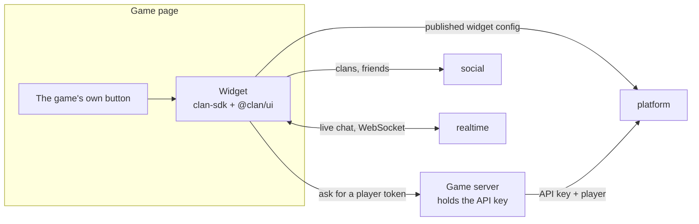

# clan-sdk

[](https://gitlab.com/clan-platform/clan-sdk/-/pipelines)


The script a game loads to get **Sociable**'s clans, friends and live chat. One script tag draws the widget the
game's developer designed and published in Studio, and talks to the Social and Realtime services for the
signed-in player. It needs no React, no bundler and no build step in the game.



The widget is drawn by `@clan/ui`, the same renderer as Studio's editor preview, so the game shows exactly what the
developer published.

## Contents

- [Installation](#installation)
- [Usage](#usage)
- [Documentation](#documentation)
- [Contributing](#contributing)
- [Known issues](#known-issues)
- [Authors and contact](#authors-and-contact)
- [License](#license)

## Installation

**In a game:** nothing to install. The SDK is hosted; add the script tag shown under [Usage](#usage).

**To work on the SDK** you need [Node.js](https://nodejs.org/) 22 or newer, and a read-only GitLab deploy token
(`read_package_registry`) for the `@clan/ui` package. The token stays in your shell, never in a file:

```powershell
git clone https://gitlab.com/clan-platform/clan-sdk.git
cd clan-sdk
$registrySecret = Read-Host 'GitLab read-only deploy token' -AsSecureString
$env:GITLAB_NPM_TOKEN = [System.Net.NetworkCredential]::new('', $registrySecret).Password
npm ci
npm run build          # dist/clan-sdk.js (script tag) and dist/clan-sdk.esm.js (ES module)
npm test
```

More on the registry, the bundles and the browser tests: [docs/development.md](docs/development.md).

## Usage

Add a container, your own button, and the script. `getPlayerToken` calls **your game server**, which trades the
game's API key for a player token; the key never reaches the browser.

```html
<button id="social-toggle" type="button">Social</button>
<div id="social-widget" hidden></div>
<script src="https://sdk.130-61-158-79.sslip.io/v1/clan-sdk.js"></script>
<script>
  const container = document.querySelector('#social-widget');
  document.querySelector('#social-toggle').addEventListener('click', () => { container.hidden = !container.hidden; });

  const sdk = ClanSDK.init({
    gameId: '<your game ID from Studio>',
    platformUrl: 'https://platform.130-61-158-79.sslip.io',
    socialUrl: 'https://social.130-61-158-79.sslip.io',
    realtimeUrl: 'https://realtime.130-61-158-79.sslip.io',
    getPlayerToken: async ({forceRefresh}) => {
      const response = await fetch(`/api/player-token?forceRefresh=${forceRefresh}`, {credentials: 'same-origin'});
      if (!response.ok) throw new Error('Player authentication failed');
      return (await response.json()).token;
    },
  });
  const widget = sdk.mountExperience({container});
  widget.ready.catch(console.error);
</script>
```

`/v1/` always serves the newest release. The ES module build, the token callback and the widget's lifecycle are in
[docs/integration.md](docs/integration.md); [demo-game](https://gitlab.com/clan-platform/demo-game) is a complete
example.

## Documentation

| Read | For |
|---|---|
| [docs/integration.md](docs/integration.md) | Adding the SDK to a game, the ES module, the player-token callback |
| [docs/configuration.md](docs/configuration.md) | How the published config becomes the UI, passing a config directly, the lifecycle, supported data |
| [docs/api.md](docs/api.md) | The friends API, the Social client API, the legacy API |
| [docs/features.md](docs/features.md) | Live chat, clan chat, leaving a clan, closed clans, member management |
| [docs/development.md](docs/development.md) | Registry install, building, tests, local verification pages |
| [docs/deployment.md](docs/deployment.md) | The Docker asset server and its deployment |

## Contributing

- **Bugs and ideas:** open a ticket in the team's tracker (`TEAM-<number>`) or an issue in this project, with the
  browser, the game page and the console output.
- **Branches:** start from `develop`, for example `fix/TEAM-123-chat-retry` or `feat/TEAM-124-clan-tags`.
- **Commits:** `type(scope): what changed (TEAM-123)`, where the type is `feat`, `fix`, `docs`, `refactor` or `test`.
- **Merge requests:** into `develop` (protected), with `npm run build`, `npm test` and `npm run test:bundle` passing.
  The build fails if a bundle reaches 60 KB gzip.
- **UI changes** belong in `@clan/ui` (clan-frontend, `packages/ui`), not here; update it with `npm update @clan/ui`
  and commit the changed `package-lock.json`.

## Known issues

The SDK relies on documented `.sk-*` and `data-key` hooks in `@clan/ui` for search, status and per-row actions, so a
change to those hooks in the renderer needs a matching change here. See
[docs/configuration.md](docs/configuration.md#supported-shared-ui-and-runtime-data).

## Authors and contact

Built by the Sociable team at Xsolla School Baku:

- Murad Hasanli
- Nuray Mukhtarli
- Farida Shakikhanli

Questions and support: sociableplatform.support@gmail.com.

## License

No license has been chosen yet, so all rights are reserved by the authors.
