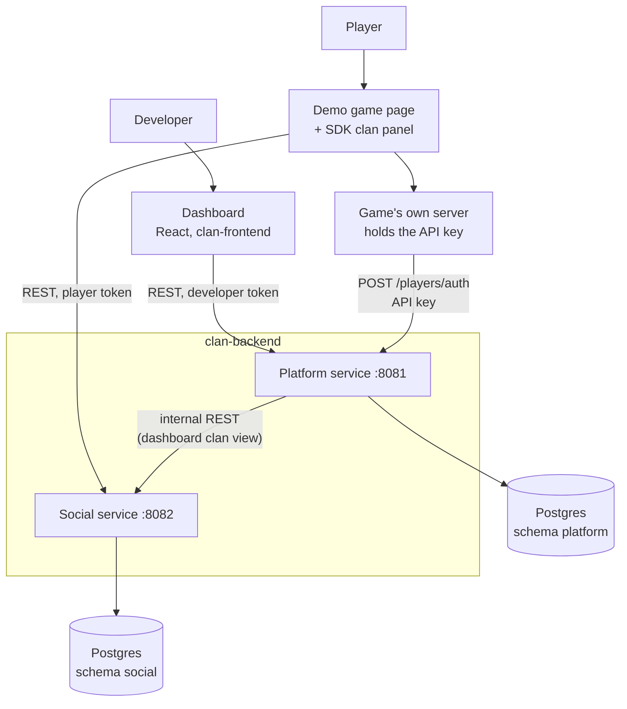

# Social Toolkit for Indie Games — System Architecture

Nov 6, 2026 · @Murad

## Overview

The product is a hosted social layer for small web games. A developer registers their existing game in a dashboard, gets an API key, and drops a JS SDK into the game. Players then get clans (and later friends and chat) without the developer building any of it.

It runs as **2 Go services** (Platform and Social) with **PostgreSQL** for storage.

**Problem.** Friends, clans and chat appear in most multiplayer games, yet each small team rebuilds them from scratch: data model, real-time messaging, UI.

**What the developer does (current scope).**

1. Signs up in the dashboard and registers their existing game.
2. Creates an API key (shown once) and keeps it on the game's own server.
3. Adds the SDK to the game; players can list, create and join clans and see members.
4. Sees the game's clans and members in the dashboard.

**Goals**

- A developer goes from new account to working clans in a game in under 30 minutes.
- Players of one game never see or change data of another game.
- The design can add Realtime (chat), friends and live config later without rewriting the first two services.

**Non-goals (this version)**

- Native engines (Unity, Godot); web games only.
- Player registration; each game keeps its own accounts.
- Chat, friends, presence, notifications (later phases).
- The widget config editor, publishing and live re-skin (later phase).
- Horizontal scaling.

## Decisions and assumptions

| Topic | Decision | Source |
| --- | --- | --- |
| Game platform | Web games (browser, JS) | Team |
| Player accounts | Owned by each game; we trust the game backend | Team |
| Team | 3 people, Nov 6 to Nov 17 (submit by 23:59) | Team |
| Deployment | Local, Docker Compose | Team |
| Backend language | Go 1.23+ | Team |
| Services | 2 Go services: Platform and Social | Team |
| Router | Standard `net/http` ServeMux, no Chi | Team |
| Frontend | React + plain JavaScript (Vite), plain CSS; no TypeScript, no Tailwind | Team |
| SDK | Plain JavaScript; the UI is a clan panel | Team |
| MVP feature scope | Clans: list, create, join, see members | Team |
| Sync calls between services | REST over the internal network (no gRPC) | *assumed* |
| Message broker | None until Realtime is added (then RabbitMQ or NATS) | *assumed* |
| Gateway | None for now; each service has its own port with CORS | *assumed* |
| Max clan size | 10 by default | *assumed* |
| Demo game backend | One tiny server for the demo game's own login and player token | *assumed* |

**Open questions**

- Should clans support invite-only joining, or open join only? (Open join only for now.)
- When Realtime is added, which message broker: RabbitMQ or NATS JetStream?
- Is a second demo game needed for the defense?

## Architecture at a glance



Reading top down: the game's server trades its API key for a player token; the SDK calls Social with that token; the dashboard calls Platform; Platform asks Social over internal REST when the dashboard needs clan data. No service reads another service's tables.

| Component | Tech |
| --- | --- |
| Platform, Social | Go 1.23+, `net/http` ServeMux, `pgx` v5, `slog`; tokens with Ed25519 (`pkg/jwt`) |
| Database | PostgreSQL 16, one instance, one schema per service, one DB user per schema |
| Migrations | `golang-migrate` or `goose`, one `migrations/` folder per service |
| Dashboard | React + JavaScript, Vite, React Router, plain CSS |
| SDK | Plain JavaScript |
| Demo game | Web page + tiny server for its own login |
| Dev and CI | Docker Compose, GitLab CI |

## Services

Each service owns one Postgres schema and never reads another service's tables; it asks over REST.

| Service | Owns | Talks to | Port | Postgres schema |
| --- | --- | --- | --- | --- |
| Platform | Developers, games, API keys, player tokens | Calls Social's internal endpoints for the dashboard's clan view | 8081 | `platform` |
| Social | Players (per game), clans, members | Nobody; verifies tokens with Platform's public key | 8082 | `social` |

### Platform service

- Developer sign-up and login (email + password, bcrypt, developer JWT).
- Register existing games (an integration record, never game creation).
- API keys per game: random, stored hashed, shown once, revocable.
- Exchanges a game server's API key + player ID for a short-lived player JWT.
- Holds the JWT **private** key; Social gets only the **public** key.
- Dashboard view of a game's clans and members, by calling Social's internal API.

### Social service

- Creates a player record the first time a token for a new `(game_id, external_player_id)` appears.
- Clans: list, create, join (open clans), my clan, members; roles owner and member.
- Enforces one clan per player per game and the clan size limit.
- Internal endpoints for Platform, protected by an internal service token.

### Shared Go packages (`pkg/`, already written)

| Package | Purpose |
| --- | --- |
| `pkg/config` | Read settings from environment variables |
| `pkg/logx` | JSON logger (`slog`) tagged with the service name |
| `pkg/pg` | PostgreSQL connection pool (`pgx`) |
| `pkg/httpx` | Error format, JSON helpers, middleware (recover, request log), server with graceful shutdown |
| `pkg/jwt` | Sign (Platform) and verify (Social) tokens with Ed25519 |

## Player authentication

The game's backend vouches for its player by calling Platform with the API key; the browser only ever holds a short-lived player JWT, never the API key.

1. The player logs into the game with the game's own account system.
2. The game backend calls `POST /api/v1/players/auth` on Platform with header `X-API-Key: <api_key>` and body `{ "externalPlayerId": "u_42", "displayName": "Rashad" }`.
3. Platform checks the key against the game, signs a JWT and returns `{ "token": "…", "expiresIn": 3600 }`.
4. The game backend hands the token to the game frontend.
5. The frontend initializes the SDK with a `getPlayerToken()` function. The SDK sends the token on every call to Social.
6. Social verifies the signature with Platform's public key. No call to Platform is needed.
7. On a 401 the SDK calls `getPlayerToken()` once more and retries.

**Player JWT claims** (as implemented in `pkg/jwt`)

```json
{
  "sub": "u_42",
  "gid": "a6c1…",
  "name": "Rashad",
  "typ": "player",
  "iat": 1762340000,
  "exp": 1762343600
}
```

- Algorithm: `EdDSA` (Ed25519). Any other algorithm, including `none`, is rejected.
- **Developer JWT** has `typ: "developer"` and `sub` = developer ID. Social rejects it; player endpoints accept only `typ: "player"`.
- Every query in Social filters by `gid` from the token, never by a game ID sent in the request.

## Data model

One Postgres 16 instance with two schemas; every player-facing table carries `game_id`; IDs are UUIDs.

### Schema `platform`

```sql
create table developers (
  id uuid primary key,
  email text unique not null,
  password_hash text not null,
  name text not null,
  created_at timestamptz not null default now()
);

create table games (
  id uuid primary key,
  developer_id uuid not null references developers(id),
  name text not null,
  description text,
  created_at timestamptz not null default now()
);

create table api_keys (
  id uuid primary key,
  game_id uuid not null references games(id),
  key_prefix text not null,               -- first characters, to show in the dashboard
  key_hash text not null,                 -- sha256 of the full key
  created_at timestamptz not null default now(),
  revoked_at timestamptz
);
```

### Schema `social`

```sql
create table players (
  id uuid primary key,
  game_id uuid not null,
  external_id text not null,              -- the game's own player ID
  display_name text not null,
  created_at timestamptz not null default now(),
  unique (game_id, external_id)
);

create table clans (
  id uuid primary key,
  game_id uuid not null,
  name text not null,
  owner_id uuid not null references players(id),
  member_count int not null default 1,
  max_members int not null default 10,
  created_at timestamptz not null default now()
);
create unique index clans_game_name on clans (game_id, lower(name));

create table clan_members (
  clan_id uuid not null references clans(id) on delete cascade,
  player_id uuid not null references players(id),
  game_id uuid not null,
  role text not null,                     -- owner | member
  joined_at timestamptz not null default now(),
  primary key (clan_id, player_id),
  unique (game_id, player_id)             -- one clan per player per game
);
```

**Notes**

- `member_count` is updated in the same transaction as `clan_members`, with a row lock (`select … for update`), so two players cannot exceed `max_members` at once.
- Each service connects with its own database user that can only use its own schema.

## REST API

All endpoints are JSON under `/api/v1` on each service's own port. Errors use one shape (implemented in `pkg/httpx`):

```json
{ "error": { "code": "clan_full", "message": "Clan has reached 10 members" } }
```

Contracts go in `openapi/platform.yaml` and `openapi/social.yaml` so all three people build against the same spec.

### Platform (`:8081/api/v1`)

| Method | Path | Auth | Purpose |
| --- | --- | --- | --- |
| POST | `/developers/register` | none | Create developer account |
| POST | `/developers/login` | none | Log in, returns developer token |
| GET | `/developers/me` | developer | Current developer |
| GET | `/games` | developer | List my games |
| POST | `/games` | developer | Register an existing game |
| GET | `/games/{gameID}/api-keys` | developer | List keys (prefix only) |
| POST | `/games/{gameID}/api-keys` | developer | Create key; full key returned once |
| DELETE | `/api-keys/{keyID}` | developer | Revoke key |
| POST | `/players/auth` | API key | Issue player JWT |
| GET | `/games/{gameID}/clans` | developer | Game's clans (via Social) |
| GET | `/games/{gameID}/clans/{clanID}/members` | developer | Clan members (via Social) |

### Social (`:8082/api/v1`, player token)

| Method | Path | Purpose |
| --- | --- | --- |
| GET | `/players/me` | My player profile (created on first call) |
| GET | `/clans?q=` | List or search clans of my game |
| POST | `/clans` | Create clan `{ name }` (3–20 characters, unique per game) |
| POST | `/clans/{clanID}/join` | Join an open clan |
| GET | `/players/me/clan` | My clan and role, or 404 |
| GET | `/clans/{clanID}/members` | Members with display name and role |

### Internal only (Social, internal service token, not for browsers)

| Path | Purpose |
| --- | --- |
| `GET /internal/games/{gameID}/clans` | Clans for the dashboard |
| `GET /internal/clans/{clanID}/members` | Members for the dashboard |

### Every service also has

| Path | Answer |
| --- | --- |
| `GET /health` | 200 while the process runs |
| `GET /ready` | 200 when the database answers, otherwise 503 `not_ready` |

## JS SDK and in-game rendering

The SDK is plain JavaScript that the game includes. In this version it only does clans.

```js
const clans = ClanSDK.init({
  socialUrl: "http://localhost:8082",
  getPlayerToken: () => fetch("/api/clan-token").then(r => r.json()).then(j => j.token),
  container: document.getElementById("clan-panel")
});
```

| Part | Job |
| --- | --- |
| Core client | `listClans`, `createClan`, `joinClan`, `myClan`, `clanMembers`; adds the token, retries once on 401 |
| Clan panel, no clan | Clan list with Join buttons, Create clan form |
| Clan panel, in a clan | Clan name, my role, members list |

Rules: the API key never appears in SDK code; text is rendered with `textContent`, never `innerHTML`.

## Developer dashboard

A React + JavaScript single-page app (Vite, React Router, plain CSS).

| Page | What the developer does |
| --- | --- |
| Sign up / Log in | Create account, log in, log out |
| Games | Register an existing game (wording: "Register existing game", never "Create game") |
| API keys | Create (shown once, with copy button), list, revoke |
| Clans | See the game's clans and member counts; open a clan to see its members |

## Demo game

One small web game with its own tiny server.

| Part | What it does |
| --- | --- |
| Game server | Nickname login (the game's own); endpoint that calls `POST /players/auth` with the API key from an environment variable and returns the player token |
| Game page | The game plus the SDK clan panel; shows the player's clan name in the header |

**Defense demo (current scope)**

1. Developer logs in, registers the game, creates an API key.
2. Two browsers, two players: one creates a clan, the other sees it and joins; both see two members.
3. The dashboard shows the clan and its members.
4. Show that a token from another game cannot see these clans.

## Security and multi-tenancy

The rule that must never break: a player of game A can never read or change anything of game B, so `game_id` always comes from the verified token.

| Risk | Control |
| --- | --- |
| Data leaks across games | `game_id` from token only; tests that try cross-game access |
| API key leaked in browser | Key used only server to server; stored hashed; shown once; revocable |
| Forged player tokens | Ed25519 signing; only Platform has the private key; expiry 1 h; algorithm fixed |
| Wrong token type | Player endpoints reject developer tokens and the other way around |
| Internal endpoints called from outside | Internal service token; not part of the public CORS setup |
| Clan over capacity under race | Row lock on the clan when joining |
| XSS | SDK and dashboard render text with `textContent` |
| SQL injection | `pgx` with parameters only |
| Developer passwords | bcrypt; login rate limit |
| Internal errors leaking | Non-app errors become a generic 500 (`pkg/httpx`) |

## Deployment and repositories

**GitLab group `clan-platform`**

| Repo | Contents |
| --- | --- |
| `clan-backend` | Both Go services and shared code |
| `clan-frontend` | Developer dashboard |
| `clan-sdk` | JavaScript SDK |
| `demo-game` | Demo game and its tiny server |

**`clan-backend` layout (already written)**

```
clan-backend/
├── go.mod                     # one Go module for the repo
├── pkg/                       # config, logx, pg, httpx, jwt
├── services/
│   ├── platform/              # cmd/main.go, internal/{handler,service,repository}, migrations/
│   └── social/                # same structure
├── .env.example
└── README.md
```

Each service is its own program (`go run ./services/platform/cmd`, `go run ./services/social/cmd`). Go's `internal` rule stops one service from importing the other's code. One `go.mod` was chosen over `go.work` because `go build ./...` from the repo root does not reach nested modules.

**Containers (Docker Compose)**

| Container | Port |
| --- | --- |
| postgres | 5432 |
| platform | 8081 |
| social | 8082 |

The dashboard and the demo game run with their own dev servers for now.

**Configuration** through environment variables (`PLATFORM_PORT`, `PLATFORM_DATABASE_URL`, `SOCIAL_PORT`, `SOCIAL_DATABASE_URL`, `LOG_LEVEL`, JWT key files, internal service token) in a `.env` file that is not committed; `.env.example` is committed.

**Testing**

- Unit tests for rules (JWT, error format, handlers; clan rules next).
- Integration tests with a real Postgres for clan rules, including the join race.
- GitLab CI runs `go build`, `go vet` and `go test` on every push.

**Git workflow**

- `main` is protected; one branch per Jira ticket, e.g. `TEAM-12-create-clan`.
- The Jira key goes in branch names, commit messages and merge request titles (GitLab for Jira Cloud links them).
- Every merge request is reviewed by one teammate.

## Key end-to-end flows

**Flow 1: player opens the game**

1. Game backend gets a player token from Platform (`POST /players/auth` with the API key).
2. SDK calls `GET /players/me` on Social; Social creates the player row on first sight.
3. SDK calls `GET /players/me/clan`; 404 shows the no-clan panel.

**Flow 2: create and join**

1. Player A: `POST /clans { name }`. Social creates the clan and makes A the owner in one transaction.
2. Player B: `GET /clans`, then `POST /clans/{id}/join`. Social locks the clan row, checks the limit, adds B.
3. Both: `GET /clans/{id}/members` shows two members.

**Flow 3: join a full clan**

1. C: `POST /clans/{id}/join`.
2. Social locks the clan row and sees `member_count = max_members`.
3. Returns `409 { code: "clan_full" }`; the SDK shows the message.

**Flow 4: developer views clans**

1. Dashboard: `GET /games/{gameID}/clans` on Platform with the developer token.
2. Platform checks the developer owns the game, then calls Social's `GET /internal/games/{gameID}/clans` with the internal token.
3. Platform returns the list to the dashboard.

## Team split and timeline

Each person owns an area end to end. Contracts (OpenAPI, error format, token claims) are agreed first so work runs in parallel. Tasks are in Jira (space `TEAM`).

| Person | Owns | Jira tasks |
| --- | --- | --- |
| Murad Hasanli | Platform service, dashboard | T4–T8, T17–T20 |
| Farida Shakikhanli | Backend infrastructure, Social service | T1–T3, T9–T16 |
| Nuray Muxtarli | SDK clan panel, demo game | T21–T25 |

**Proposed phases**

| Dates | Goal |
| --- | --- |
| Nov 6 | Backend skeleton (done), Docker Compose, OpenAPI contracts agreed |
| Nov 7–10 | Platform: auth, games, API keys, player tokens. Social: clans endpoints. SDK core client |
| Nov 11–13 | Dashboard pages, SDK clan panels, demo game |
| Nov 14–15 | Integration, tests, fixes |
| Nov 16–17 | Buffer, demo script, defense preparation |

Integrate on `main` daily so problems show up the same day.

## Future work and scaling

The design grows by adding pieces rather than rewriting. Steps 1–4 are the planned next phases; the rest are for the defense discussion.

| Step | Change | Unlocks |
| --- | --- | --- |
| 1 | **Realtime service** (WebSocket, `coder/websocket`) with a message broker (RabbitMQ or NATS) | Clan chat, presence, notifications |
| 2 | **Friends** in Social: requests, friendships, blocks | Friend lists, direct messages |
| 3 | **Widget config** in Platform: drafts, published versions, rollback | Developers customize look and behavior |
| 4 | **Live re-skin**: publish pushes `config.updated` through Realtime | Open games change look without reload |
| 5 | Gateway (Traefik) in front of all services | One public entry, central CORS and rate limits |
| 6 | Outbox pattern, dead-letter queue, idempotent consumers | No lost events |
| 7 | Second demo game with a different config | Shows the toolkit is generic |
| 8 | Redis presence and pub/sub between Realtime instances | Several Realtime containers, load tests |
| 9 | Unity / Godot SDKs, framework plugins (e.g. Phaser) | Native and framework games |
| 10 | Moderation: kick, transfer ownership, disband, report, mute | Real-world games |
| 11 | Prometheus, Grafana, OpenTelemetry | Production monitoring |

Detailed designs for Realtime (WebSocket protocol, events, message rules) and the widget config schema will be added when steps 1, 3 and 4 start.
